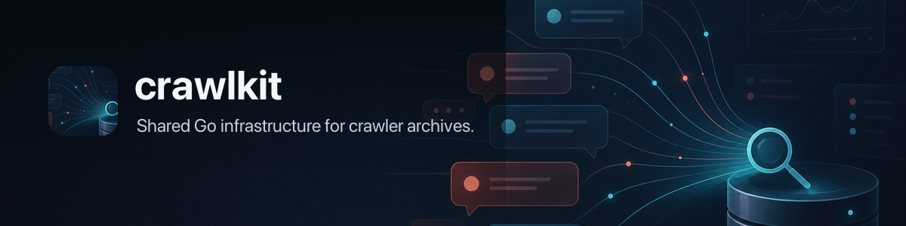

# crawlkit 🧰 — one kit, many crawlers



[](https://github.com/openclaw/crawlkit/actions/workflows/ci.yml)
[](https://pkg.go.dev/github.com/openclaw/crawlkit)
[](https://go.dev/)
[](LICENSE)

`crawlkit` is the shared Go library for local-first crawler archives. It gives crawler authors provider-neutral building blocks for config paths, SQLite stores, snapshots, backups, synchronization, search, terminal interfaces, and automation.

Provider APIs, authentication, schemas, privacy filters, and user-facing command contracts stay in the downstream crawl apps.

## Install

`crawlkit` requires Go 1.27.0 or newer.

Development builds prefer Go 1.27.4 through the `toolchain` directive in `go.mod`.

Add the package you need to a Go module. For the quick start below:

```sh
go get github.com/openclaw/crawlkit/store@latest
```

Install the optional archive controller:

```sh
go install github.com/openclaw/crawlkit/cmd/crawlctl@latest
```

The latest module version is available through the Go module proxy. Signed CLI archives and the release process are documented in [Publishing Crawlkit](docs/publishing.md).

## Quick start

This example opens an in-memory SQLite store with crawlkit's connection defaults, applies a schema, writes a row, and reads it back:

```go
package main

import (
	"context"
	"fmt"

	"github.com/openclaw/crawlkit/store"
)

func main() {
	ctx := context.Background()
	db, err := store.Open(ctx, store.Options{
		Path:   ":memory:",
		Schema: `create table items (title text not null)`,
	})
	if err != nil {
		panic(err)
	}
	defer db.Close()

	if _, err := db.DB().ExecContext(ctx, `insert into items values (?)`, "first crawl"); err != nil {
		panic(err)
	}
	rows, err := db.Query(ctx, `select title from items`)
	if err != nil {
		panic(err)
	}
	fmt.Println(rows.Values[0]["title"])
}
```

Run it from a module that depends on `crawlkit`:

```sh
go run .
```

```text
first crawl
```

## Package map

| Area | Packages | What they own |
| --- | --- | --- |
| Local data | `config`, `store`, `state`, `cache` | Runtime paths, SQLite access, sync cursors, and safe cache snapshots |
| Portable archives | `snapshot`, `backup`, `mirror` | JSONL/Gzip packs, encrypted backups, sidecars, and Git-backed history |
| Search | `embed`, `vector` | Embedding providers, vector encoding, exact search, and result fusion |
| App contracts | `control`, `output`, `progress` | Machine-readable metadata, output formats, and CI-safe progress logs |
| Remote archives | `remote` | Provider-neutral HTTP client and versioned archive protocol |
| Background processing | `worker` | Bounded continuous workers over application-owned durable queues |
| User surfaces | `scheduler`, `tui`, `releasecheck` | Refresh jobs, terminal browsing, and release notices |

See the [package guide](docs/packages.md) for the complete inventory and [Go package reference](https://pkg.go.dev/github.com/openclaw/crawlkit) for exported APIs.

## crawlctl

`crawlctl` discovers installed crawl apps through their machine-readable metadata, runs configured refresh jobs under a held OS lock, and records JSONL run history.

Discovery and refresh commands allow two seconds for inherited output pipes to
close after the command exits or its context is canceled. A descendant that
keeps a pipe open then produces an error instead of blocking the controller and
its run lock indefinitely. This does not impose a runtime limit on active jobs
or terminate descendant processes.

The lock file is persistent: do not remove or replace it to unlock the runner.
Closing the owning handle or exiting releases the lock. Keep its directory
private; on Windows, file access follows the directory's ACLs. Unsupported OS
locking fails closed.

Stop all old runners before upgrading from PID-file locking. Legacy or ambiguous
lock contents require an explicit stopped-runner migration: verify all old
runners are stopped, archive that legacy file once, then start the new runner.
There is no mixed old/new runner safety or automatic stale-PID reclamation.

Default discovery checks `gitcrawl`, `discrawl`, `notcrawl`, `wacrawl`,
`telecrawl`, `slacrawl`, `graincrawl`, `imsgcrawl`, `photoscrawl`, and `weicrawl`.
Use `--app` to select binaries explicitly. Discovery does not automatically
schedule source-specific commands such as Photos' `import_apple`.
Discovery reports malformed metadata and missing manifest IDs in the app's
`error` field. Supported legacy binaries retain their fallback manifests.

If a write is interrupted, history reads ignore a truncated final JSON value and the next run repairs that tail before appending. Valid final records without a trailing newline are retained; complete corrupt records still report an error.

History reads accept the full records written by the runner, including long
command arguments. Explicit configuration paths work without a home directory;
default and `~/` paths still require one. Saving a controller configuration
applies private file permissions before replacing existing content.

| Command | Purpose |
| --- | --- |
| `init` | Discover crawl apps and write a controller config |
| `discover` | Print discovered crawl apps |
| `run` | Run enabled refresh jobs |
| `status` | Show the latest recorded job status |
| `logs` | Print recent job logs |
| `install` | Install or render a periodic schedule |
| `uninstall` | Remove an installed periodic schedule |

Scheduling uses launchd on macOS, systemd user units on Linux, Task Scheduler on Windows, and cron rendering as the portable fallback. Cron requires whole-minute intervals below one hour that divide 60 evenly, such as `5m`, `12m`, or `30m`; other intervals are rejected because minute steps restart each hour.

Launchd and systemd plans require whole-second intervals of at least one minute.

Cron plans escape percent signs in executable, config, and log paths before
cron processes the command, including when adjacent to literal backslashes.
Paths containing line feeds are rejected because each cron entry must occupy
one physical line.

Systemd plans preserve literal argument text, including quotes, percent signs,
and dollar signs. Executable paths must follow systemd rules: quotes,
backslashes, and control characters are rejected before installation.
Dry-run previews can still render plans for another operating system.

See [Background workers](docs/background-workers.md) for content-triggered processing alongside ingestion.

## Private native backup transport

`crawlctl preservation` transfers existing native backup files to the opt-in
admin-only preservation API in `crawl-remote`. It does not query a provider,
prune a store, decompress a backup, or activate a publication. Configure the
service's dedicated private preservation bucket before using it. Enabling these
routes advertises the `admin` auth role; keep them on an isolated endpoint until
existing contract consumers support that role. The default base contract and
existing archive publication paths remain unchanged.

Provide the admin credential through an environment variable managed by your
normal credential helper. Do not put a credential on the command line. For
example, with `PRESERVATION_TOKEN` already injected:

```sh
crawlctl preservation upload \
  --endpoint https://archive.example.com \
  --app discrawl --archive discrawl/example \
  --token-env PRESERVATION_TOKEN \
  --file native.sqlite.zst=/backups/native.sqlite.zst \
  --file media/attachment.bin=/backups/attachment.bin > upload-receipt.json

crawlctl preservation download \
  --endpoint https://archive.example.com \
  --app discrawl --archive discrawl/example \
  --token-env PRESERVATION_TOKEN \
  --manifest <manifest_sha256-from-receipt> \
  --output /restore/new-empty-destination
```

Keep the upload receipt in the recovery inventory. Its `manifest_sha256` pins
all file names, complete-file hashes, and ordered chunk hashes. Repeating an
unchanged upload reuses immutable object identities; it does not fetch upstream
data again. The default chunk size is 64 MiB; `--chunk-size` can reduce it. A
manifest supports up to 64 nonempty files and 256 chunks, at most 16 GiB. For a
larger inventory, retain every separate manifest digest explicitly. The default
per-request timeout is five minutes and can be set with `--timeout`.

For a source file larger than one manifest, `--file-range
NAME=OFFSET:LENGTH:PATH` reads an exact section without creating a temporary
copy. Offset and length are decimal byte counts; length must be positive and
the section must fit the source file. For example, an 8 GiB section can use
`--file-range pack.part-000=0:8589934592:/backups/archive.pack`. Use a separate
archive identifier for each volume. The library equivalent is
`PreservationSource.Offset` and `PreservationSource.Length`; leaving both zero
keeps the whole-file behavior.

A section receipt verifies only those selected bytes. Retain the original
file size and SHA-256, each section's offset and length, and all manifest pins
in the recovery inventory. Restore each pinned volume, concatenate in recorded
offset order, and verify the original complete-file checksum before declaring
the original file recoverable. Range upload does not provide a snapshot of a
file that is still changing.

Upload reads sources twice and holds at most one chunk plus bounded copy buffers
at a time. Sources must already be closed, coherent backups: use the native
SQLite backup owner first, not an actively written database/WAL pair. Source
size, each chunk, and the complete-file hash are checked before manifest
publication. Failed uploads can leave private unreferenced chunks; they never
publish a successful receipt or change the current archive.

Download creates a new destination (0700 directories and 0600 files on Unix)
and never overwrites an existing directory. On Windows, use a parent directory
with an appropriately restricted ACL. It verifies the exact manifest bytes, every downloaded
chunk, and each complete file. Failure leaves a reported partial destination;
retry into another new directory. Success reports `files_verified: true`, while
`restore_qualified` remains false. Decompress separately, run SQLite integrity
and native fidelity checks, and account for external files before declaring a
backup recoverable or changing retention. This transport does not certify
upstream freshness, exclusion policy, query coverage, or restored schemas.

The same operations are available through `remote.PlanPreservation`,
`Client.UploadPreservation`, `Client.FetchPreservationManifest`, and
`Client.DownloadPreservationFile`. A failed download may have written partial
bytes to the supplied writer; callers must discard those bytes.

## Boundaries

`crawlkit` accepts shared mechanics only when they are provider-neutral, reusable by at least two apps, and preserve each app's database and CLI contracts. The [ownership map](docs/boundary.md) tracks what belongs here and what remains in GitHub-, Discord-, Slack-, Notion-, and other provider-specific applications.

The `remote` package owns the Go client and v1 wire contract for hosted archives. Worker deployment, D1 schema, authentication policy, and secrets live outside this module; see the [remote contract](docs/remote-contract.md) and [Cloudflare archive design](docs/cloudflare-remote-archives.md).

## Safety

Tests and examples use temporary or in-memory data. They do not access app runtime stores such as `~/.config/gitcrawl`, `~/.slacrawl`, `~/.discrawl`, or `~/.notcrawl`.

Snapshot imports reject absolute and parent-traversing shard paths while preserving literal root and shard names, including current-directory roots. This is a lexical check: snapshots must still come from a trusted filesystem tree because shard reads follow symlinks.

Pass a plain filesystem path to `store.Open` unless SQLite driver parameters are intentional. A caller-supplied `file:` URI keeps its query parameters, which can override crawlkit's default pragmas or fail connection validation.

## Development

```sh
make check
```

This runs module tidiness, formatting, vet, dead-code and vulnerability checks, unit tests, and race tests with `GOWORK=off`. See [CONTRIBUTING.md](CONTRIBUTING.md) for the compatibility rules.

Keep `modernc.org/libc` at the exact version required by the selected `modernc.org/sqlite` module. SQLite v1.62.0 requires libc v1.80.1; its runtime dependency must be updated together with SQLite, not independently.

SQLite operations waiting for a write lock honor their context cancellation or deadline, including during the default five-second busy timeout.

When nesting JSON produced by a scalar subquery inside another JSON constructor,
mark the subquery result explicitly with `json(...)`, for example
`json_array(json((select json_group_array(value) from items)))`. SQLite 3.54
does not preserve the JSON subtype through that subquery boundary. Explicit
conversion also works on SQLite 3.53 and keeps arrays from becoming quoted strings.

## License

[MIT](LICENSE)
